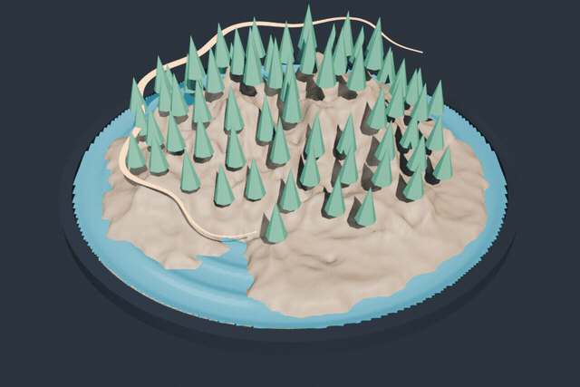
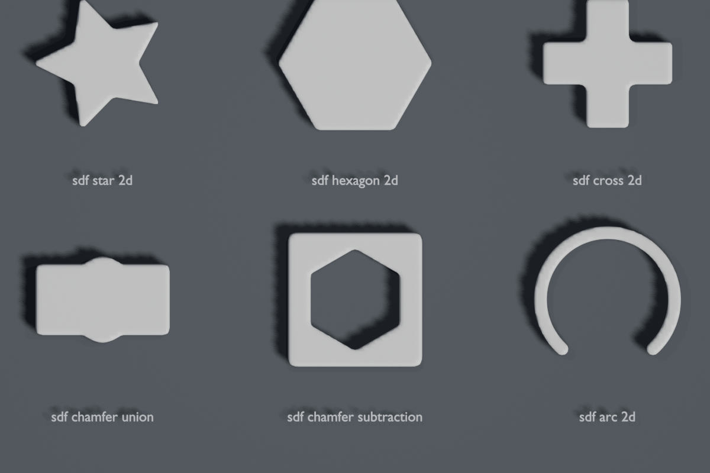
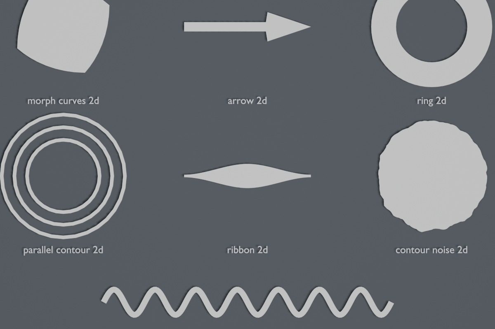
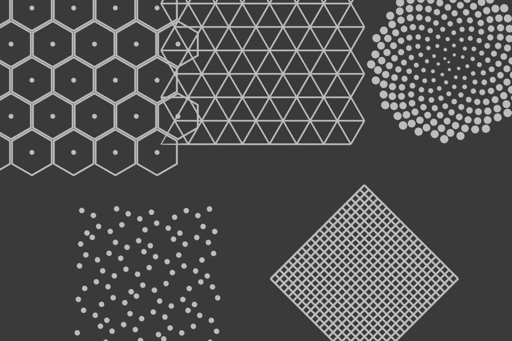
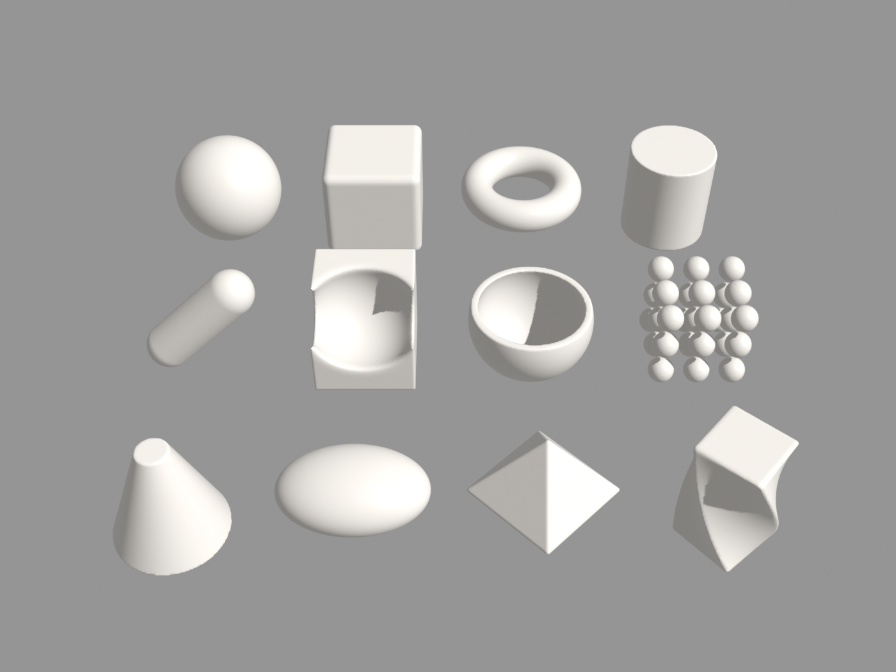

# base-node-library

Text format (`.bn`) for node graphs. Reads and writes node trees as functions.

```bn
use math (bump)

geometry graph relief(geometry: Geometry, height: Float = 0.4 in 0.0..2.0) -> Geometry {
  "Displaces vertices along Z using a radial bump"
  h = bump(length(Position()) / 3.0, 0.5, 0.2) * height
  return SetPosition(geometry, offset: CombineXYZ(z: h))
}
```

| [`examples/chrono_hud.bn`](examples/chrono_hud.bn) | [`examples/living_diorama.bn`](examples/living_diorama.bn) | [`examples/metaball_symphony.bn`](examples/metaball_symphony.bn) |
|---|---|---|
|  |  |  |

| `stdlib/sdf2d.bn` | `stdlib/curves2d.bn` |
|---|---|
|  |  |
| **`stdlib/patterns2d.bn`** | **`stdlib/math.bn`** |
|  |  |

## Layout

| Path | Description | License |
|---|---|---|
| [`spec/reference.md`](spec/reference.md) | `.bn` grammar and semantics | MIT OR Apache-2.0 |
| [`profiles/`](profiles/) | Target profiles (`core`, `sdf2d`, `vector2d`, `ink2d`, `raster2d`, `blender-geometry`) | MIT OR Apache-2.0 |
| [`stdlib/`](stdlib/) | Standard `.bn` modules (`math`, `sdf2d`, `curves2d`, `patterns2d`, `gp_tools2d`) | MIT OR Apache-2.0 |
| [`conformance/`](conformance/) | Shared `.bn` test corpus and expected ASTs | MIT OR Apache-2.0 |
| [`python/`](python/) | Zero-dependency Python parser, formatter, and CLI (`base_node`) | MIT OR Apache-2.0 |
| [`rust/`](rust/) | `wasm32`-compatible Rust parser, formatter, and profile checker (`base-node`) | MIT OR Apache-2.0 |
| [`base-node-for-blender/`](base-node-for-blender/) | Blender 5.2+ extension (`Tree ⇄ Text` live sync) | GPL-3.0-or-later |

## Profiles

Each profile extends its parent and restricts allowed types, implicit inputs, zones, and nodes:

```text
core              Scalar/vector math, logic, noise, repeat (math.bn)
 └─ sdf2d         + 2D spatial context: Position, Normal, Index, ID (sdf2d.bn)
     ├─ vector2d  + Geometry, 2D curves/meshes/points/instances, foreach (curves2d.bn, patterns2d.bn)
     │   └─ ink2d + Living ink, GP3 strokes, dynamics, tilt, draw_time (gp_tools2d.bn)
     │       └─ blender-geometry  + Full Blender 5.2+ Geometry Nodes (3D, volumes, closures, bundles)
     └─ raster2d  + Image buffers, blend modes, filters, rasterize/vectorize
```

## Python (`python/`)

Install from GitHub or a local checkout:

```bash
# From GitHub (pip / uv)
pip install "base-node @ git+https://github.com/marcgardent/base-node-library.git#subdirectory=python"

# From a local clone
pip install -e ./python
```

Or in `pyproject.toml`:

```toml
dependencies = [
  "base-node @ git+https://github.com/marcgardent/base-node-library.git#subdirectory=python",
]
```

CLI:

```bash
base-node fmt file.bn
base-node fmt --check file.bn
base-node check --profile vector2d stdlib/curves2d.bn
base-node ast file.bn
```

Library API:

```python
import base_node as bn

ast = bn.parse(source)
formatted = bn.format_source(source)
errors = bn.check_profile(graphs, profile="vector2d")
```

Run tests:

```bash
PYTHONPATH=python pytest python/tests
```

## Rust (`rust/`)

Add to `Cargo.toml` (Cargo discovers `rust/Cargo.toml` in the repository automatically):

```toml
[dependencies]
# From GitHub
base-node = { git = "https://github.com/marcgardent/base-node-library.git", branch = "main" }

# Or from a local checkout
# base-node = { path = "../base-node-library/rust" }
```

Or via `cargo add`:

```bash
cargo add --git https://github.com/marcgardent/base-node-library.git base-node
```

Library API:

```rust
use base_node::{check_profile, format_source, parse, ProfileKind};

let file = parse(src, "example.bn")?;
let formatted = format_source(src, "example.bn")?;
let errors = check_profile(&file, ProfileKind::Vector2d);
```

Run tests and check WebAssembly target:

```bash
cd rust
cargo test
cargo check --target wasm32-unknown-unknown
```

## Blender Extension (`base-node-for-blender/`)

Add-on for Blender 5.2+ (`id = "base_node"`).
Provides live two-way sync between the Node Editor and Text Editor (`Ctrl+Enter` to apply, `Ctrl+Space` to autocomplete).

Run headless Blender tests:

```bash
blender --background --factory-startup --python-exit-code 1 \
  --python base-node-for-blender/tests/test_extension.py
```

## License

- `spec/`, `profiles/`, `stdlib/`, `conformance/`, `python/`, `rust/`: [MIT](LICENSE-MIT) OR [Apache-2.0](LICENSE-APACHE).
- `base-node-for-blender/`: GPL-3.0-or-later.
